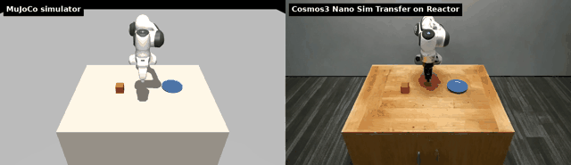
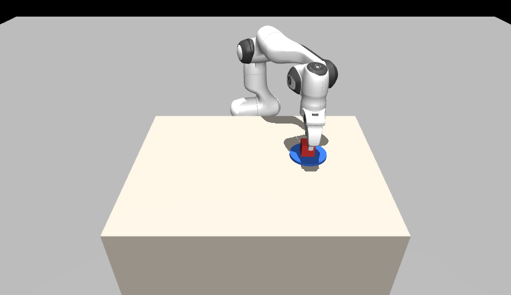
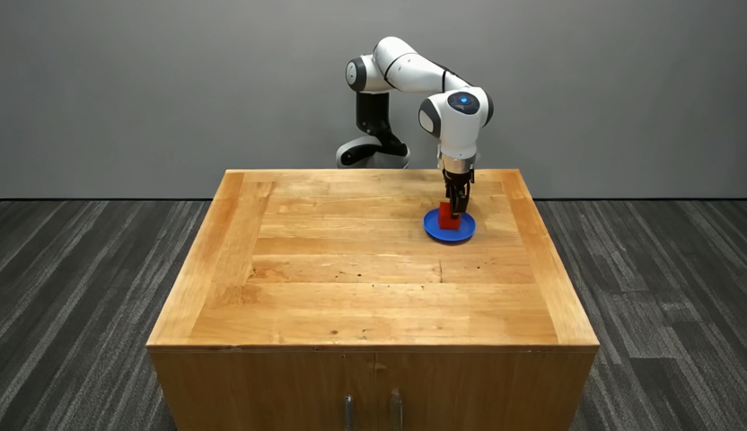
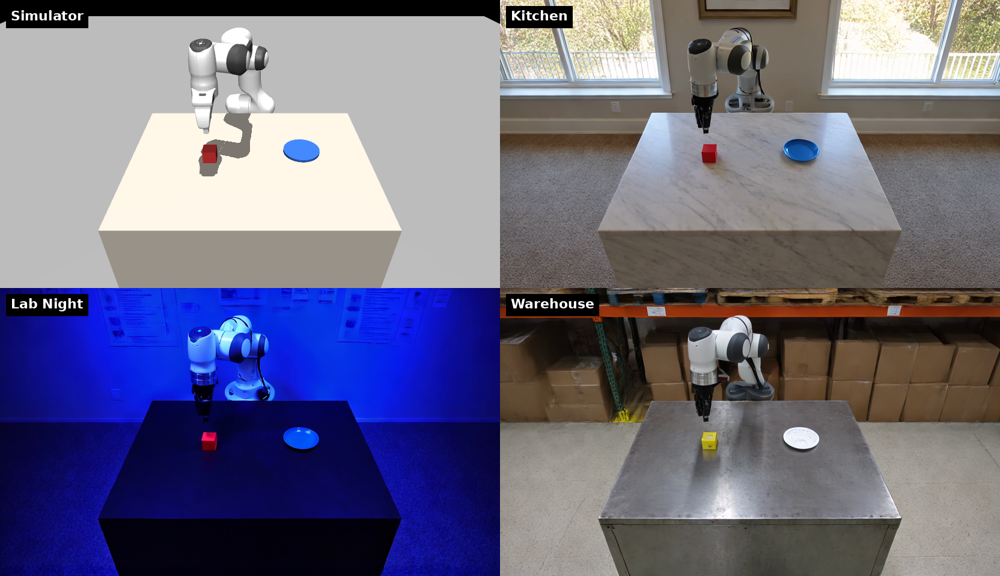

# Your simulator, photoreal: MuJoCo + Cosmos Transfer on Reactor

A working, closed-loop integration of an open-source robot simulator with NVIDIA's **Cosmos3 Nano Sim Transfer**, running live on [Reactor](https://docs.reactor.inc/robotics/simulation-and-synthetic-data). Reactor's docs describe how to connect "your simulator" and its cookbook replays prepared test depth; this example plugs in a real one, MuJoCo, with a robot arm doing a pick-and-place, so a robotics team can see their own setup end to end.



| Simulator frame | Cosmos Transfer frame |
|---|---|
|  |  |

Same motion, three appearance prompts, no change to the simulator:



Full videos: [side by side](results/side_by_side.mp4) · [simulator, depth sent, Cosmos output](results/pipeline.mp4) · [variants](results/variants.mp4)

## What happens each step

```
policy picks actions ──> MuJoCo advances 4 frames ──> depth (832x480, 8-bit) ──> Reactor: Cosmos Transfer
        ^                                                                              │
        └──────────────── newest photoreal RGB frame = next observation <──────────────┘
```

This is Reactor's documented loop for connecting a simulator: `initialize` with one depth frame, then `advance` with four at a time, pausing simulation time while each group renders. The simulator still owns physics and task success; Cosmos only changes how the frames look.

## Measured on this run

From [`results/report.json`](results/report.json) and [`results/variants_report.json`](results/variants_report.json), run from a GitHub Actions runner (US):

| | Value |
|---|---|
| Episode | 161 frames at 30 FPS (5.4 s of robot time), 832x480 |
| Time per 4-frame step (median) | 1.10 s (range 0.99 to 1.63 s) |
| Session time for the episode | 60.4 s, about 11x slower than robot time |
| Cost of the episode | about $0.10 (60.4 s at $0.102 per session-minute) |
| Three 61-frame appearance variants | 16 to 19 s each, about $0.03 each |

Two honest notes: the scripted policy reads simulator state, not pixels (a learned policy would read the Cosmos frame the loop hands it); and in the warehouse variant the model changed the cube to yellow and the plate to white because the prompt did not name colors, so name anything your task depends on.

## Run it yourself (about 15 minutes)

Requires Python 3.11+ and a Reactor API key with access to `reactor/cosmos3-nano-sim-transfer`.

```bash
git clone https://github.com/Abdullah-coder25/Robot-Fleet-Inference
cd Robot-Fleet-Inference/cosmos-transfer-mujoco
pip install -r requirements.txt
python run_demo.py --dry-run            # simulator + depth only, free; first run downloads the Franka model
export REACTOR_API_KEY=rk_...           # keep keys out of code and client-side apps
python run_demo.py                      # closed loop through Cosmos Transfer (~1 minute, ~$0.10)
python run_demo.py --variants           # optional: three appearance prompts on the recorded depth
python make_video.py                    # side_by_side.mp4, pipeline.mp4, variants.png
```

On a headless Linux server set `MUJOCO_GL=osmesa` (install `libosmesa6`). Or skip local setup: add `REACTOR_API_KEY` as a repository secret and run the **Cosmos Transfer + MuJoCo demo** workflow in GitHub Actions; it commits the videos to `results/`.

## Bring your own simulator: first-working-build checklist

1. **Camera:** render at exactly one supported canvas (832x480 for 16:9). The API rejects other sizes rather than resizing.
2. **Depth in meters:** MuJoCo's depth renderer already returns meters. Other simulators may return a nonlinear depth buffer; linearize it first.
3. **Fixed bounds:** map depth to 8-bit with the same near/far for the whole episode (near = white, far = black). Per-frame normalization makes still objects flicker in brightness. See `render_depth_png_array` in [`sim.py`](sim.py).
4. **Frame count:** `total_frames` must be 1 + 4N (here 161). `initialize` takes 1 depth frame; every `advance` takes exactly 4.
5. **Match results:** check `episode_id` and `step_index` on every `step_result`, and verify the returned hashes; the same reply can arrive twice. See `CosmosTransfer` in [`run_demo.py`](run_demo.py).
6. **Prompt:** describe appearance only. Motion comes from your simulator; name colors and objects your task depends on.

| Symptom | Likely cause |
|---|---|
| `step_failed` on `initialize` | wrong canvas size, or depth sent as 16-bit or float instead of an 8-bit RGB PNG |
| Objects flicker or swim | near/far bounds changing between frames |
| Wrong colors or objects in the output | prompt too vague about what must stay the same |
| `Set REACTOR_API_KEY` | key missing from the environment |

## Files

- [`sim.py`](sim.py): MuJoCo scene (Franka Panda from [MuJoCo Menagerie](https://github.com/google-deepmind/mujoco_menagerie), Apache-2.0, fetched on first run), scripted pick-and-place policy, depth export.
- [`run_demo.py`](run_demo.py): the closed loop against Reactor, plus `--dry-run` and `--variants`.
- [`make_video.py`](make_video.py): side-by-side video, GIF and variants grid.
- [`../.github/workflows/cosmos-transfer-demo.yml`](../.github/workflows/cosmos-transfer-demo.yml): runs everything in GitHub Actions.

Sources: [Reactor simulation docs](https://docs.reactor.inc/robotics/simulation-and-synthetic-data), [connect a simulator](https://docs.reactor.inc/robotics/cosmos/nano-sim-transfer/connect-a-simulator.md), [Transfer pricing](https://docs.reactor.inc/robotics/cosmos/nano-sim-transfer/overview), [reactor-cookbook](https://github.com/reactor-team/reactor-cookbook). Built by Abdullah Usman, November 2026. Not affiliated with Reactor or NVIDIA.
